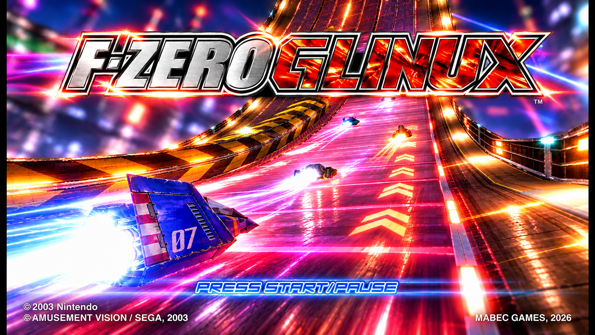
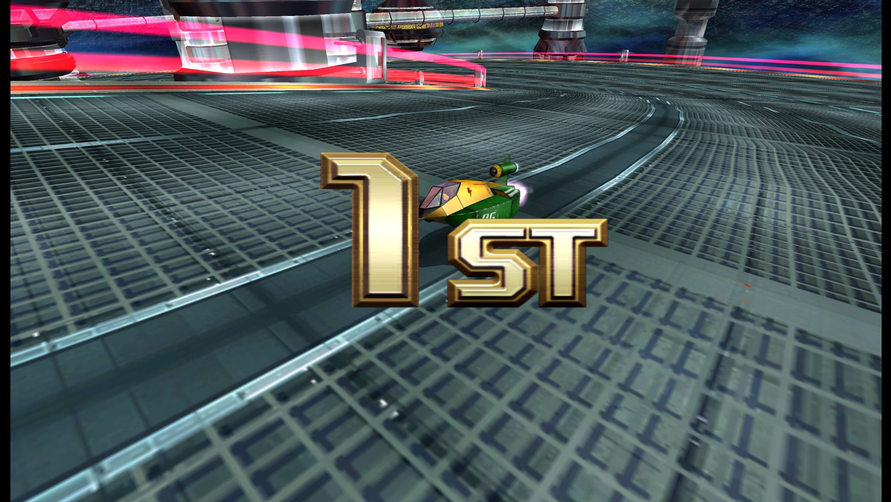
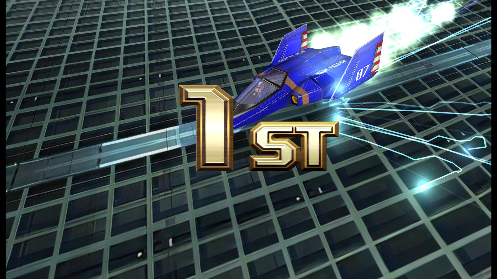
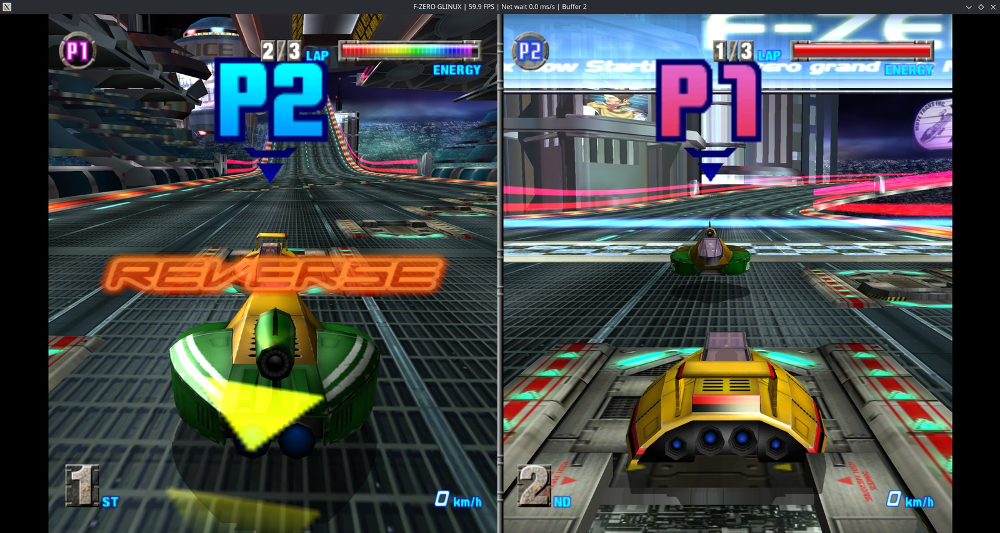
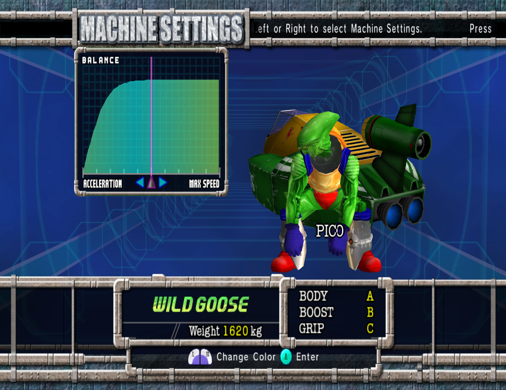
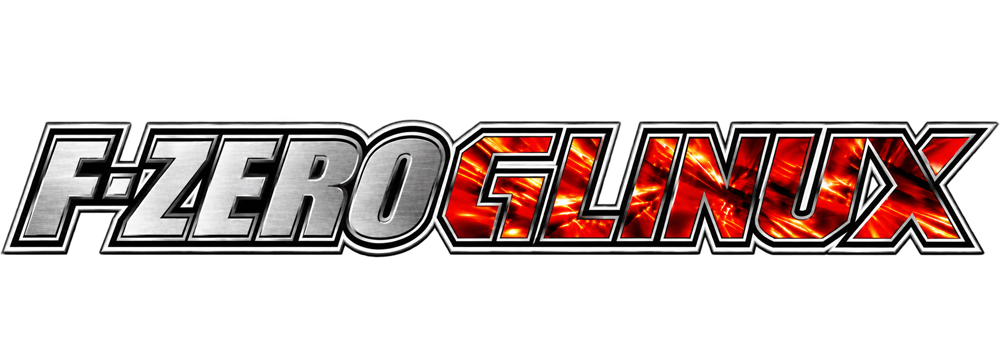

<p align="center">
  
</p>

<h1 align="center">F-ZERO GLINUX</h1>
<p align="center"><strong>Choose your machine. Set your resolution. Hit the track.</strong><br>F-ZERO GX on Linux and Windows, with a controller-friendly launcher.</p>
<p align="center">
  <a href="#choose-your-package">AppImage, Flatpak & Windows</a> ·
  <a href="#start-playing">Start playing</a> ·
  <a href="#unlock-everything">Unlockables</a> ·
  <a href="#mods--hd-textures">Mods</a> ·
  <a href="#play-online">Play online</a> ·
  <a href="#build-from-source">Build from source</a> ·
  <a href="#project-status">Project status</a>
</p>

F-ZERO GLINUX brings together a custom launcher, graphics settings and modern
controller options around a Dolphin-derived runtime.
Static recompilation with JIT through ModernGekko remains
experimental; these packages are not a completed static recompilation release.

Bring your own **F-ZERO GX USA (`GFZE01`) or PAL (`GFZP01`)** image in **ISO or RVZ** format. Game
disc contents and personal memory-card saves are not included in the packages.
**WIP, Issues may occur, blame the robots... but if it works its all thanks to me.**

## Built for the starting grid

- **USA (`GFZE01`) & PAL (`GFZP01`) support:** import either region's ISO or RVZ; PAL boots with 60Hz (`EuRGB60`) enabled for full 60 FPS gameplay.
- **Controller-friendly launcher** with racing artwork, gamepad navigation and clear loading feedback.
- **Nine resolution presets:** 480p, Steam Deck-sized 800p, 720p, 1080p, 1080p Ultrawide (2560×1080), 1440p, 1440p Ultrawide (3440×1440), 4K and 4K Ultrawide (5120×2160).
- **Graphics options:** VSync, FXAA or 4× MSAA, texture filtering and fullscreen.
- **Boost on X:** optional X/Y swap for modern four-button gamepads.
- **Native widescreen:** use GX's own Screen Mode setting for 16:9. A 21:9 display option and three ultrawide output presets fill ultrawide monitors, but the game's 16:9 picture is stretched sideways (camera not widened, experimental).
- **Exit confirmation:** Escape opens a prompt; D-pad selects, A confirms and B resumes.
- **Separate user data:** saves and settings survive package updates.
- **Mods:** add HD texture packs and Dolphin graphics mods from any folder.
- **Online play:** host a room and share a 4-word room code; no IP addresses needed.
- **Unlock everything & Local Gecko Codes (Experimental):** one switch gives 99,999 tickets and unlocks every cup, machine, Gold Part, Staff Ghost, Story chapter and shop song (works in both Local and Online play), plus 15 optional Ralf Gecko codes for Local Play (*Experimental - A work in progress*; automatically disabled in Online rooms).
- **Windows build:** a portable zip for Windows 10/11, with the same launcher and features.

The current target is the game's normal **60 FPS** operation.
Performance and available AA modes depend on your hardware.

<p align="center">
  
  <br><em>Alright, First place!</em>
</p>

## Unlock everything

Open **CHEATS & UNLOCKS** in the launcher and switch on
**Unlock Everything & Max Tickets (99,999)**. The unlocks are applied automatically
every time the game starts; there are no button codes to enter:

- **99,999 tickets** to spend in the F-Zero Shop.
- **All cups**, including the **AX Cup** and its tracks.
- **Every machine**, including the AX machines and **Dark Schneider**.
- **Every custom part**, including the **15 Gold Parts** from the hidden shop codes
  discovered in 2026. They are listed under F-Zero Shop > Custom Parts at
  15 tickets each, under their part names:

  | Gold machine | Body | Cockpit | Booster |
  |---|---|---|---|
  | Thunderstorm | Rage Knight | Hyper Stream | Velocity -J |
  | El Dorado | Metal Shell | Round Disk | Shuttle -M2 |
  | Chrono Symphony | Blood Raven | Maximum Star | Crown -77 |
  | Bahamut | Mad Bull | Crazy Buffalo | Mars -EX |
  | Gladiator | Galaxy Falcon | Rush Cyclone | Hornet -FX |

  Buy the three parts, then assemble them as a new machine in the **Garage**.
- **Sounds of MUTE CITY** and **Sounds of BIG BLUE** for sale under F-Zero Shop >
  Items (99 tickets). Press **Z** when choosing a Mute City or Big Blue course to
  race with the remix; the normal music stays.

Unlocked content is written to your memory card the next time the game saves, so
it stays after the switch is turned off. Back up your save first if you want to
keep an untouched one. The original button codes are still listed in the launcher,
and the Gold Parts codes work with a single controller.

## Mods & HD textures

<p align="center">
  
  <br><em>The <a href="https://forums.dolphin-emu.org/Thread-f-zero-gx-hd-ai-05-01-2022">F-ZERO GX HD</a> texture pack running in F-ZERO GLINUX.</em>
</p>

The launcher's **MODS** section supports Dolphin texture packs and graphics mods:

1. Download a mod, for example the
   [F-ZERO GX HD texture pack](https://forums.dolphin-emu.org/Thread-f-zero-gx-hd-ai-05-01-2022)
   , and unpack it anywhere.
2. Open **MODS**, choose **Add mod folder…** and pick the mod's folder.
3. Start the game.

The launcher detects the mod type on its own: texture packs contain `.dds`/`.png`
files, graphics mods a `metadata.json`. Each mod can be switched on or off, and your
files stay where you put them. Mods only change what your own screen shows, so they
also work in online play. Mods are made by their own authors and are not included
with F-ZERO GLINUX.

## Play online

<p align="center">
  
  <br><em>Two players racing online, at full speed.</em>
</p>

Open **PLAY ONLINE** in the launcher. One player chooses **Host a room** and gets a
4-word room code such as `FALCON-PICO-SAMURAI-ZERO`; the others paste that code and
choose **Join room**. No IP addresses to share. Then pick **VS Battle** in the game.

Online play is built on Dolphin netplay, so it currently works like local
multiplayer:

- **Split screen for up to 4 players.** Every player sees the same shared
  split-screen picture, not their own full-screen view (yet).
- **VS Battle only.** Grand Prix and Time Attack have a single player.
- **No CPU racers** in VS Battle.
- The slowest machine sets the pace for everyone, so a quick connection and
  similar hardware give the smoothest races.

## Choose your package

| | AppImage | Flatpak |
|---|---|---|
| Start | Make executable, then open the file | Install once, then open from your app menu |
| Dependencies | Bundled libraries plus the host's base system | Application built inside a matching Freedesktop SDK; uses its Platform runtime |
| Current compatibility | Release build requires **glibc 2.35+** (Ubuntu 22.04, Debian 12 or newer) | Avoids that host-glibc dependency by using Freedesktop **26.08** |
| Best fit | Compatible, recent Linux systems; portable single-file launch | The preferred candidate for older distros and Bazzite testing |
| Game import | Browse to your own ISO/RVZ | Put the ISO/RVZ in Downloads, which the sandbox can read |
| Save location | `~/.local/share/fzero-glinux` by default | `~/.var/app/io.github.mabecgames.FZeroGLinux/data/fzero-glinux` |

The two packages keep separate profiles. Switching package formats does not
automatically transfer your saves.

**Windows** (10/11, x64) uses a portable zip: unpack it anywhere and run it, no
installer or extra runtime needed. Saves are stored in `%LOCALAPPDATA%\fzero-glinux`.

## Start playing

The filenames below are those of the **v0.9** release. When building locally,
find them in `dist/`. See [Releases](https://github.com/Mabec-games/F-ZERO-GLINUX/releases)
for any published downloads; source publication does not automatically publish binaries.

### AppImage

```bash
chmod +x F-ZERO-GLINUX-0.9-glibc2.35-x86_64.AppImage
./F-ZERO-GLINUX-0.9-glibc2.35-x86_64.AppImage
```

If FUSE is unavailable, run:

```bash
./F-ZERO-GLINUX-0.9-glibc2.35-x86_64.AppImage --appimage-extract-and-run
```

The release AppImage is smoke-tested on Ubuntu 22.04 and 24.04, Debian 12 and
Fedora 40. Builds made on a newer host can need a newer glibc.
See [AppImage packaging and compatibility](packaging/README.md).

### Flatpak

With Flatpak and the Flathub remote available:

```bash
flatpak install --user ./F-ZERO-GLINUX-0.9-x86_64.flatpak
flatpak run io.github.mabecgames.FZeroGLinux
```

The app also appears in your desktop application menu after installation.
This is a locally distributed bundle, not a Flathub store listing. To configure
the runtime source if needed:

```bash
flatpak remote-add --user --if-not-exists flathub https://dl.flathub.org/repo/flathub.flatpakrepo
```

### Windows

1. Download `F-ZERO-GLINUX-0.9-windows-x64.zip` and unpack it to any folder.
2. Run `F-ZERO GLINUX.exe`. If SmartScreen warns about an unknown publisher,
   choose **More info → Run anyway**; the preview is not code-signed.

Direct3D 11 is the default graphics backend; Vulkan and Direct3D 12 are available
in the launcher. The first start of the game compiles shaders and can take a few
minutes on slower GPUs; later starts are fast.

### First launch

1. Select **Browse for ISO / RVZ** and import your USA (`GFZE01`) or PAL (`GFZP01`) game image. For Flatpak, use Downloads. PAL versions automatically run with 60Hz mode enabled.
2. Open **Controller**, choose your gamepad and optionally enable **Boost on X**.
3. Choose your graphics settings, then press **PLAY**. The loading screen stays visible while the game starts.
4. Create your own player name in-game. For widescreen, enable the game's native Screen Mode option and select the matching 16:9 or 21:9 display setting in the launcher.

To exit a race, press **Escape**, then use the D-pad and A/B on the confirmation
window. Offline play pauses while the prompt is open; an online session keeps
running. A controller shortcut to *open* this prompt is not currently documented
as supported—Steam Deck users can map a button to Escape through Steam Input.

<p align="center">
  
  <br><em>Fine-tune your machine before the race.</em>
</p>

## Build from source

```bash
git clone --recurse-submodules https://github.com/Mabec-games/F-ZERO-GLINUX.git
cd F-ZERO-GLINUX
```

The project pins upstream submodules and carries its changes as patches. The
build scripts apply those patches; generated game modules are not committed.

**Flatpak:** install `flatpak`, `flatpak-builder`, Python 3 and Git, then:

```bash
flatpak install --user flathub org.freedesktop.Sdk//26.08 org.freedesktop.Platform//26.08
JOBS=4 bash scripts/build-flatpak.sh
```

This compiles inside the SDK rather than reusing host binaries. See the
[Flatpak build guide](packaging/flatpak/README.md) for permissions and troubleshooting.

**AppImage:** with a C++23 toolchain, CMake, Ninja and the development dependencies
installed, build the runtime and package it using `linuxdeploy`:

```bash
bash scripts/build-glinux.sh
bash scripts/package-appimage.sh
```

See the [AppImage build guide](packaging/README.md) and
[upstream template's dependency notes](docs/UPSTREAM-TEMPLATE.md). Building on a
newer host can raise the resulting AppImage's minimum system requirements.

**Windows:** install Visual Studio 2022 Build Tools with
"Desktop development with C++", CMake and Ninja. Clone to a short path such as
`C:\dev`: the nested submodules exceed Windows' 260-character path limit in deep
folders. Then, in PowerShell:

```powershell
winget install --id Microsoft.VisualStudio.2022.BuildTools -e --override "--wait --passive --add Microsoft.VisualStudio.Workload.VCTools --includeRecommended"
winget install --id Kitware.CMake -e
winget install --id Ninja-build.Ninja -e
powershell -ExecutionPolicy Bypass -File scripts\build-windows.ps1
powershell -ExecutionPolicy Bypass -File scripts\package-windows.ps1
```

The package is a portable zip in `dist\`; run `F-ZERO GLINUX.exe`. Saves and the
imported game are stored in `%LOCALAPPDATA%\fzero-glinux`.

## Project status

| Area | Status |
|---|---|
| AppImage and Flatpak | Working on the project owner's development machine |
| Game versions | NTSC-U (`GFZE01`) and PAL (`GFZP01`) supported (PAL runs at 60Hz) |
| JIT gameplay | Playable; smooth 60 FPS reported on that machine |
| Static recompilation | Experimental; performance work remains |
| Native widescreen / 21:9 | 16:9 in-game setting; 21:9 only stretches the 16:9 picture, no widened camera yet (research: `ULTRAWIDE-FINDINGS.md`) |
| Steam Deck / Bazzite / Debian | Target testing remains; 800p preset is available |
| Windows | Working: portable zip built with MSVC; launcher, gamepad and audio confirmed with Direct3D 11 and Vulkan. Online play not yet tested on Windows |
| Online play | Working between two machines with 4-word room codes; split screen, up to 4 players |
| Mods | HD texture packs and Dolphin graphics mods from any folder |
| Unlockables & Cheats | Automatic unlocks (all machines, cups, Gold Parts, shop songs, staff ghosts) + local Gecko codes (*Experimental - Work in progress*) |

Report problems with your package type, distro, graphics backend, GPU and gamepad,
along with the relevant log. 

## Credits

Project presentation and Linux launcher work by **Mabec Games**.

Built on [ModernGekko](https://github.com/ExpansionPak/ModernGekko),
[DolRecomp](https://github.com/ExpansionPak/DolRecomp) and
[Dolphin](https://github.com/dolphin-emu/dolphin), starting from
[ModernGekko-Template](https://github.com/ExpansionPak/ModernGekko-Template).
Upstream components retain their respective licenses and attribution; see their
submodules and the notices included with packaged builds. F-ZERO GX, its imagery
and related trademarks belong to their respective owners. This is an independent
fan project, not an official Nintendo or SEGA release.

<p align="center">
  
  <br><strong>See you on the starting grid.</strong>
</p>
